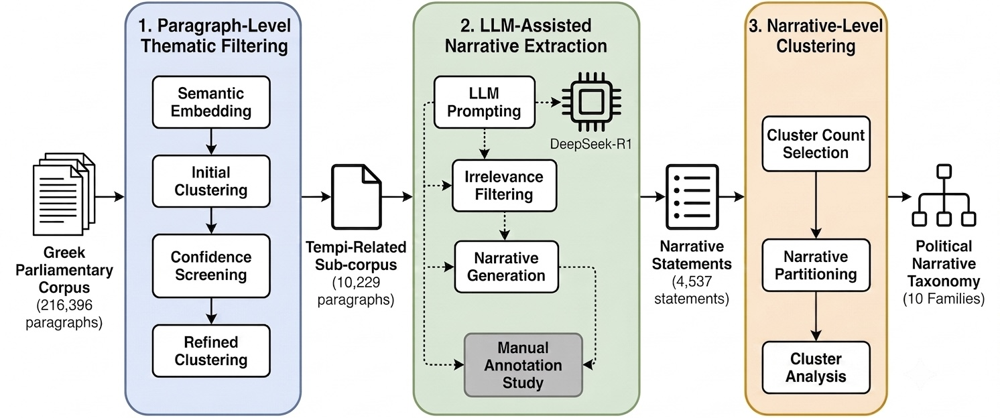
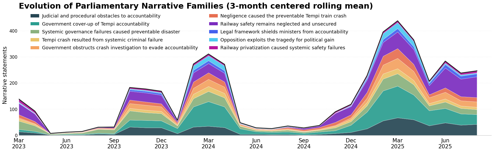

# CART
### Clustering-based Analysis of Recurring narratives for Taxonomy construction

CART is an unsupervised, clustering-based framework designed to identify, extract, and organize recurring political narratives from large-scale textual data without requiring predefined narrative categories or extensively annotated training datasets.

Constructing a taxonomy of political narratives traditionally requires substantial manual effort, including the identification of relevant textual material, the interpretation of recurring narrative patterns, and the development of a classification scheme. These tasks become increasingly challenging when analyzing large collections of political discourse, where narratives may be expressed through diverse linguistic formulations and evolve over time.

CART addresses these challenges by integrating semantic embeddings, unsupervised confidence-guided thematic screening, LLM-assisted narrative extraction, and quality-driven cluster discovery within a unified analytical workflow. Rather than starting from a predetermined set of narrative labels, the framework identifies recurring patterns in the data and progressively organizes them into an interpretable narrative taxonomy.

The approach is designed to reduce the dependence on extensive manual annotation, facilitate the exploration of large textual corpora, and support the systematic identification of narrative structures that might otherwise be difficult to detect through manual analysis alone.

The methodology is developed and demonstrated through an analysis of Greek parliamentary discourse surrounding the 2023 Tempi railway disaster. Using a corpus of 216,396 parliamentary paragraphs, CART combines paragraph-level thematic filtering, LLM-assisted narrative extraction, and narrative-level clustering to identify recurring political narratives concerning the disaster, institutional responsibility, accountability, and railway safety.

The resulting taxonomy comprises ten political narrative families, providing a structured representation of the dominant narrative patterns emerging from parliamentary debates and enabling their subsequent comparative and temporal analysis.

This repository provides the analytical notebooks, datasets, intermediate outputs, original LLM prompts, and visualizations documenting the complete research workflow.

## Research Pipeline

CART employs a three-stage workflow that progressively transforms unstructured parliamentary discourse into an interpretable taxonomy of recurring political narratives.

The first stage identifies thematically relevant paragraphs through semantic representations, clustering, and confidence-based screening. The second stage employs DeepSeek-R1 to extract narrative statements from the selected material. Finally, the extracted statements are semantically grouped into recurring narrative families through narrative-level clustering.



## Repository Structure

```text
cart/
│
├── framework/
│   ├── 00_dataset_integrity_check.ipynb
│   ├── 01_preparation.ipynb
│   ├── 02_screening_extraction.ipynb
│   └── 03_narrative_clustering.ipynb
│
├── dataset/
│   ├── 1_preparation/
│   │   ├── 01_paragraphs_clean.csv.zip
│   │   ├── 01_stopwords_all.txt
│   │   └── 05_Tempi_paragraphs_clean.csv.zip
│   │
│   ├── 2_screening_extraction/
│   │   ├── 02_cluster_metadata.csv
│   │   ├── 02_clusters_with_titles.csv
│   │   ├── 02_dataset_clustered.csv.zip
│   │   ├── 03_tempi_df_dataset.csv
│   │   ├── 04_tempi_df_R1_narratives.csv
│   │   ├── 05_tempi_df_R1_extra_narratives.csv
│   │   ├── 05_tempi_df_R1_invalid_jsons.csv
│   │   ├── 06_tempi_df_R1_final_narratives.csv
│   │   └── par_embeddings.npy
│   │
│   └── 3_narrative_taxonomy/
│       ├── narrative_embeddings.npy
│       └── narrative_taxonomy_ksil.csv
│
├── annotation/
│   ├── analysis/
│   │   ├── annotation_results_analysis.ipynb
│   │   └── error_analysis_similarity.ipynb
│   │
│   ├── annotations/
│   │   ├── annotation_1.xlsx
│   │   ├── annotation_2.xlsx
│   │   ├── annotation_3.xlsx
│   │   ├── annotation_4.xlsx
│   │   └── annotation_5.xlsx
│   │
│   ├── guidelines.pdf
│   ├── annotation_sheet.xlsx
│   └── narratives_clean.xlsx
│
├── prompts_used/
│   ├── 02_cluster_titles_prompt.txt
│   ├── 02_narrative_extraction_prompt.txt
│   └── 02_narrative_extraction_retry_prompt.txt
│
└── taxonomy/
    └── narrative_taxonomy_ksil.csv
```
## Workflow

The CART implementation is organized into three sequential analytical notebooks, accompanied by a separate dataset integrity verification notebook. Together, they document the transformation of parliamentary discourse into a structured taxonomy of recurring political narratives.

### Notebooks

| Notebook | Main Function | Data Processing and Outputs |
|---|---|---|
| [`01_preparation.ipynb`](framework/01_preparation.ipynb) | **Corpus preparation** | Processes the initial paragraph-level parliamentary corpus, applies preprocessing and filtering procedures, and produces the cleaned paragraph dataset. The notebook also generates descriptive visualizations of the parliamentary corpus. |
| [`02_screening_extraction.ipynb`](framework/02_screening_extraction.ipynb) | **Thematic screening and narrative extraction** | Performs paragraph-level semantic clustering and confidence-based screening, identifies Tempi-related parliamentary material, and applies DeepSeek-R1 to extract narrative statements. The workflow includes cluster metadata, LLM-generated cluster titles, extraction validation, and retry procedures. |
| [`03_narrative_clustering.ipynb`](framework/03_narrative_clustering.ipynb) | **Narrative taxonomy construction** | Loads the extracted narrative statements and their semantic embeddings, performs narrative-level clustering and cluster-quality analysis, and produces the final narrative taxonomy. |

The notebooks are designed to be followed in numerical order, reflecting the successive stages of the research methodology. Each stage builds on the datasets and intermediate results associated with the preceding stage.

### Dataset Integrity Verification

The repository also includes [`00_dataset_integrity_check.ipynb`](framework/00_dataset_integrity_check.ipynb), a standalone utility for verifying the accessibility and integrity of the published research datasets.

The notebook checks the readability and structure of the available data files, including the embedding arrays distributed through Git LFS. It displays a validation report without modifying the published datasets or generating additional research outputs.

## Datasets and Research Outputs

The repository provides the datasets, semantic embeddings, and intermediate research outputs associated with the three stages of the CART workflow.

These files document the progression from the initial paragraph-level parliamentary corpus to the extraction of political narrative statements and the construction of the final narrative taxonomy.

### 1. Corpus Preparation

**Directory:** [`dataset/1_preparation/`](dataset/1_preparation/)

This directory contains the initial paragraph-level parliamentary corpus, the linguistic resources used during preprocessing, and the resulting cleaned dataset.

| File | Description | Role in the Workflow |
|---|---|---|
| [`05_Tempi_paragraphs_clean.csv.zip`](dataset/1_preparation/05_Tempi_paragraphs_clean.csv.zip) | Initial paragraph-level parliamentary corpus containing 216,396 paragraphs and associated metadata. | Source dataset loaded by `01_preparation.ipynb`. |
| [`01_stopwords_all.txt`](dataset/1_preparation/01_stopwords_all.txt) | Published list of Greek stopwords, including domain-specific terms used in parliamentary discourse analysis. | Linguistic resource used during text preprocessing and cluster interpretation. |
| [`01_paragraphs_clean.csv.zip`](dataset/1_preparation/01_paragraphs_clean.csv.zip) | Preprocessed parliamentary corpus containing 117,716 paragraphs after the application of the cleaning and filtering procedures. | Main input dataset for paragraph-level thematic screening in `02_screening_extraction.ipynb`. |

The preprocessing stage applies text normalization and corpus filtering procedures to prepare parliamentary paragraphs for semantic analysis.

The corresponding implementation is provided in [`01_preparation.ipynb`](framework/01_preparation.ipynb).

### 2. Thematic Screening and Narrative Extraction

**Directory:** [`dataset/2_screening_extraction/`](dataset/2_screening_extraction/)

This directory contains the intermediate outputs of paragraph-level semantic clustering, thematic screening, and LLM-assisted narrative extraction.

The published files document both the identification of Tempi-related parliamentary material and the subsequent extraction and validation of narrative statements.

#### Thematic Screening

| File | Description | Role in the Workflow |
|---|---|---|
| [`par_embeddings.npy`](dataset/2_screening_extraction/par_embeddings.npy) | Semantic embeddings representing the cleaned parliamentary paragraphs. | Input to paragraph-level clustering and confidence-based screening. |
| [`02_dataset_clustered.csv.zip`](dataset/2_screening_extraction/02_dataset_clustered.csv.zip) | Parliamentary paragraph dataset enriched with clustering results. | Published checkpoint used for thematic screening and downstream cluster analysis. |
| [`02_cluster_metadata.csv`](dataset/2_screening_extraction/02_cluster_metadata.csv) | Cluster-level metadata, including representative terms, representative paragraphs, and associated confidence information. | Supports the interpretation and examination of identified thematic clusters. |
| [`02_clusters_with_titles.csv`](dataset/2_screening_extraction/02_clusters_with_titles.csv) | Cluster metadata supplemented with LLM-generated descriptive titles. | Supports the identification of clusters associated with the Tempi railway disaster. |
| [`03_tempi_df_dataset.csv`](dataset/2_screening_extraction/03_tempi_df_dataset.csv) | Selected parliamentary paragraphs identified as relevant to the Tempi disaster. | Input corpus for LLM-assisted narrative extraction. |

#### Narrative Extraction and Validation

| File | Description | Role in the Workflow |
|---|---|---|
| [`04_tempi_df_R1_narratives.csv`](dataset/2_screening_extraction/04_tempi_df_R1_narratives.csv) | Results of the initial narrative extraction performed using DeepSeek-R1. | Initial extraction checkpoint used for validation and subsequent processing. |
| [`05_tempi_df_R1_invalid_jsons.csv`](dataset/2_screening_extraction/05_tempi_df_R1_invalid_jsons.csv) | Records associated with responses that did not yield valid JSON during the initial extraction. | Identifies cases requiring additional processing. |
| [`05_tempi_df_R1_extra_narratives.csv`](dataset/2_screening_extraction/05_tempi_df_R1_extra_narratives.csv) | Results of the supplementary extraction procedure applied to problematic responses. | Provides additional extraction results for the consolidation process. |
| [`06_tempi_df_R1_final_narratives.csv`](dataset/2_screening_extraction/06_tempi_df_R1_final_narratives.csv) | Final consolidated dataset of extracted political narrative statements. | Main input to narrative-level clustering and taxonomy construction. |

The screening and extraction procedures are documented in [`02_screening_extraction.ipynb`](framework/02_screening_extraction.ipynb).

The original LLM prompts used for cluster title generation, narrative extraction, and extraction retries are preserved in [`prompts_used/`](prompts_used/).

### 3. Narrative Taxonomy Construction

**Directory:** [`dataset/3_narrative_taxonomy/`](dataset/3_narrative_taxonomy/)

This directory contains the semantic representations of the extracted narrative statements and the resulting narrative taxonomy.

| File | Description | Role in the Workflow |
|---|---|---|
| [`narrative_embeddings.npy`](dataset/3_narrative_taxonomy/narrative_embeddings.npy) | Semantic embeddings of the extracted political narrative statements. | Input to narrative-level clustering and cluster-quality analysis. |
| [`narrative_taxonomy_ksil.csv`](dataset/3_narrative_taxonomy/narrative_taxonomy_ksil.csv) | Narrative-level clustering results, including the labels assigned to extracted statements. | Published output of the taxonomy construction stage. |

The corresponding analytical procedures are implemented in [`03_narrative_clustering.ipynb`](framework/03_narrative_clustering.ipynb).

The final taxonomy organizes the extracted statements into ten recurring political narrative families.

### Data Availability and Checkpoints

The repository preserves intermediate research outputs to support the inspection and reproduction of individual analytical stages.

In particular:

- Compressed CSV files (`.csv.zip`) are used for larger tabular datasets.
- NumPy arrays (`.npy`) store the semantic embeddings required for clustering.
- Published intermediate CSV files document the successive stages of thematic screening and narrative extraction.
- Large embedding files are distributed through Git LFS.

Some computationally intensive procedures are retained in the notebooks but are disabled during their default execution. In these cases, the notebooks load the corresponding published checkpoints.

Researchers can therefore follow the documented workflow and examine its intermediate results without necessarily regenerating all embeddings or repeating the original LLM inference.

## Human Annotation and Evaluation

To assess the quality of the LLM-assisted narrative extraction, a human annotation study was conducted to examine how well the generated narrative statements represent the interpretations expressed in their source parliamentary paragraphs.

The evaluation followed a forced-choice design in which annotators examined parliamentary paragraphs and selected the response that best represented the meaning of each paragraph from a set of candidate options.

The repository provides the annotation materials, individual annotation files, and analytical notebooks used to examine the evaluation results.

### Annotation Materials

**Directory:** [`annotation/`](annotation/)

| File | Description |
|---|---|
| [`guidelines.pdf`](annotation/guidelines.pdf) | Instructions and criteria used during the annotation process. |
| [`annotation_sheet.xlsx`](annotation/annotation_sheet.xlsx) | Spreadsheet template used for collecting annotation responses. |
| [`narratives_clean.xlsx`](annotation/narratives_clean.xlsx) | Narrative data prepared for human annotation. |
| [`annotations/`](annotation/annotations/) | Individual annotation spreadsheets containing the collected responses. |

### Evaluation and Error Analysis

**Directory:** [`annotation/analysis/`](annotation/analysis/)

| Notebook | Purpose |
|---|---|
| [`annotation_results_analysis.ipynb`](annotation/analysis/annotation_results_analysis.ipynb) | Analysis and aggregation of the human annotation results. |
| [`error_analysis_similarity.ipynb`](annotation/analysis/error_analysis_similarity.ipynb) | Examination of errors and semantic similarity patterns associated with the narrative extraction process. |

The annotation study focuses on the quality of the extracted narrative statements rather than the direct evaluation of the final narrative taxonomy.

## Results and Visualizations

The application of CART to Greek parliamentary discourse surrounding the Tempi railway disaster resulted in the extraction of **4,537 political narrative statements**, organized into **ten recurring narrative families**.

The resulting taxonomy captures distinct but related interpretations of the disaster, including institutional responsibility, accountability, railway safety, systemic governance failures, privatization, and political exploitation.

### Discovered Narrative Families

The following table presents the ten narrative families identified through the final K-SIL clustering solution.

| Cluster | Narrative Family |
|---|---|
| 0 | Judicial and procedural obstacles to accountability |
| 1 | Government cover-up of Tempi accountability |
| 2 | Systemic governance failures caused preventable disaster |
| 3 | Tempi crash resulted from systemic criminal failure |
| 4 | Government obstructs crash investigation to evade accountability |
| 5 | Negligence caused the preventable Tempi train crash |
| 6 | Railway safety remains neglected and unsecured |
| 7 | Legal framework shields ministers from accountability |
| 8 | Opposition exploits the tragedy for political gain |
| 9 | Railway privatization caused systemic safety failures |

These labels summarize recurring claims expressed in parliamentary discourse and should not be interpreted as factual assertions about the disaster.

The complete narrative-level clustering output is available in [`taxonomy/narrative_taxonomy_ksil.csv`](taxonomy/narrative_taxonomy_ksil.csv).

### Temporal Evolution of Narrative Families

Beyond identifying recurring narrative families, the resulting taxonomy enables the examination of how political narratives evolve over time.

The following visualization presents the monthly distribution of the discovered narrative families across the parliamentary discourse, using a three-month centered rolling mean.



The visualization illustrates changes in the relative prominence and overall volume of different narrative families throughout the period under examination.

Together, the taxonomy and its temporal representation provide a structured basis for exploring how competing interpretations of the Tempi railway disaster emerge, persist, and evolve in parliamentary debate.

## Requirements and Reproducibility

The CART workflow is implemented in Python and documented through Jupyter notebooks. The notebooks are designed for execution in a Python environment with the required scientific computing libraries and access to the published research datasets.

### Software Requirements

The main software dependencies include:

- **Python** and **Jupyter Notebook** or **Google Colab**
- **NumPy** and **pandas** for numerical computation and data processing
- **scikit-learn** and **SciPy** for dimensionality reduction, clustering, and statistical analysis
- **Matplotlib** and **Seaborn** for data visualization
- **NLTK** for text preprocessing
- **Git LFS** for retrieving large embedding files

Additional dependencies are required for specific computational stages, including `boto3` and `botocore` for LLM inference through Amazon Bedrock.

### Accessing the Repository

Clone the repository and retrieve the files managed through Git LFS:

```bash
git clone https://github.com/semoglou/cart.git
cd cart
git lfs install
git lfs pull
```

The analytical notebooks are available in the [`framework/`](framework/) directory.

Before running the analytical workflow, researchers can use [`00_dataset_integrity_check.ipynb`](framework/00_dataset_integrity_check.ipynb) to verify the accessibility and readability of the published datasets.

### Reproducing the Workflow

The three main analytical notebooks follow the successive stages of the CART methodology:

1. [`01_preparation.ipynb`](framework/01_preparation.ipynb) — Corpus preparation and preprocessing.
2. [`02_screening_extraction.ipynb`](framework/02_screening_extraction.ipynb) — Thematic screening and LLM-assisted narrative extraction.
3. [`03_narrative_clustering.ipynb`](framework/03_narrative_clustering.ipynb) — Narrative clustering and taxonomy construction.

The repository includes published intermediate datasets and semantic embeddings that can be loaded as checkpoints.

This allows researchers to inspect the workflow and reproduce downstream analyses without necessarily repeating the most computationally intensive stages.

### Computational Considerations

Full reproduction of the original experiments may require substantial computational resources, particularly for semantic embedding generation, clustering experiments, and LLM-assisted extraction.

The narrative extraction stage uses DeepSeek-R1 through Amazon Bedrock and therefore requires appropriate service access and configuration if the original inference procedures are to be repeated.

The original prompts are available in [`prompts_used/`](prompts_used/).

Researchers interested in examining the published results can instead use the provided datasets and checkpoints without performing new LLM inference.

## Acknowledgments
This work was supported by the [_Archimedes Research Unit_](https://archimedesai.gr/) at the [_Athena Research Center_](https://www.athenarc.gr/en).

<br>

<p align="center">
  
</p>

## Contact

For questions or feedback about **CART**, please contact:
- [a.semoglou@outlook.com](mailto:a.semoglou@outlook.com)
- [thomtsel1@gmail.com](mailto:thomtsel1@gmail.com)

## License

This project is licensed under the MIT License. See the [LICENSE](LICENSE) file for details.
