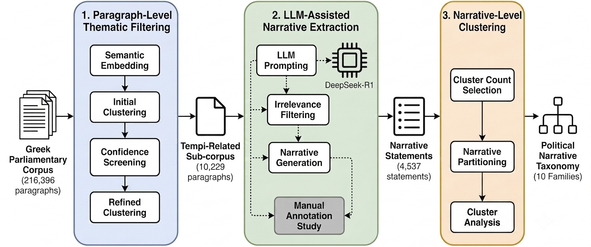
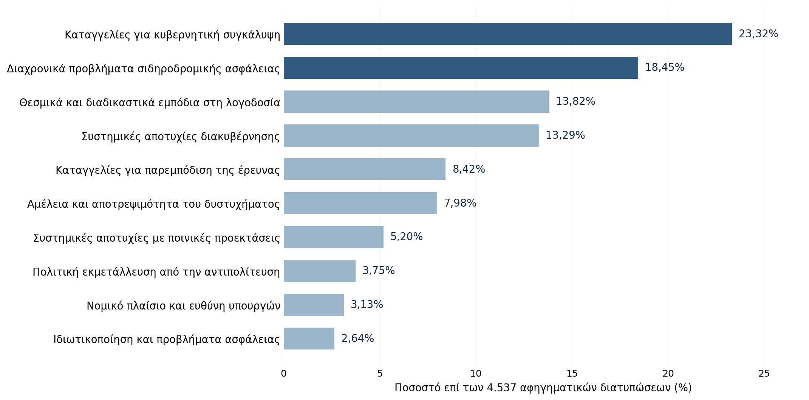
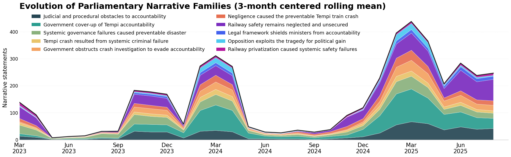

# Τέμπη: Τα πολιτικά αφηγήματα στον κοινοβουλευτικό λόγο (2023–2025)

**CART: Clustering-based Analysis of Recurring Narratives for Taxonomy Construction**

Άγγελος Σέμογλου, Θωμάς Τσελέντης, Ιωάννης Παυλόπουλος  
Οικονομικό Πανεπιστήμιο Αθηνών · Μονάδα «Αρχιμήδης», Ερευνητικό Κέντρο «Αθηνά»  
Findings of EACL · [Επιστημονικό άρθρο (arXiv)](https://arxiv.org/abs/2611.30993) · [Κώδικας και ερευνητικό υλικό](https://github.com/semoglou/cart)

## Αντικείμενο της έρευνας

Από την αναζήτηση των αιτιών του δυστυχήματος έως τις καταγγελίες για συγκάλυψη και τη συζήτηση περί θεσμικής λογοδοσίας, η τραγωδία των Τεμπών αποτέλεσε αντικείμενο εκτεταμένης κοινοβουλευτικής συζήτησης. Η εργασία εξετάζει ποιες επαναλαμβανόμενες ερμηνείες του δυστυχήματος αναδείχθηκαν στον κοινοβουλευτικό λόγο, ποιες εμφανίστηκαν συχνότερα και πώς εξελίχθηκαν με την πάροδο του χρόνου.

Ως πολιτικό αφήγημα ορίζεται εδώ ένας επαναλαμβανόμενος, ρητός ή έμμεσος ισχυρισμός που προωθεί μια συγκεκριμένη ερμηνεία ενός πολιτικού ζητήματος. Μια οικογένεια αφηγημάτων περιλαμβάνει διατυπώσεις με συναφές νόημα, ακόμη και όταν χρησιμοποιούν διαφορετικές λέξεις.

## Δεδομένα και μεθοδολογία

Η ανάλυση καλύπτει τα πρακτικά του Ελληνικού Κοινοβουλίου από τις 7 Μαρτίου 2023 έως τις 28 Αυγούστου 2025. Για την επεξεργασία τους αναπτύχθηκε το υπολογιστικό πλαίσιο CART, το οποίο συνδυάζει μηχανική μάθηση και μεγάλα γλωσσικά μοντέλα (LLMs).

| Στάδιο | Πλήθος |
| :--- | ---: |
| Ομιλίες στο αρχικό υλικό | 88.058 |
| Αρχικές παράγραφοι | 216.396 |
| Παράγραφοι μετά την προεπεξεργασία | 117.716 |
| Υποψήφιες σχετικές παράγραφοι | 10.229 |
| Εξαχθείσες αφηγηματικές διατυπώσεις | 4.537 |
| Οικογένειες αφηγημάτων | 10 |

Η διαδικασία περιλαμβάνει τρία βασικά στάδια:

1. **Θεματικός εντοπισμός:** Τα κείμενα μετατρέπονται σε αριθμητικές αναπαραστάσεις του νοήματός τους (embeddings). Με τεχνικές μη επιβλεπόμενης μάθησης πραγματοποιείται η ομαδοποίησή τους (clustering) και εκτιμάται ο βαθμός εμπιστοσύνης με τον οποίο κάθε κείμενο ανήκει στην ομάδα του. Στόχος είναι να εντοπιστούν θεματικές ενότητες που ενδέχεται να σχετίζονται με τα Τέμπη.
2. **Εξαγωγή αφηγημάτων:** Ένα μεγάλο γλωσσικό μοντέλο (DeepSeek-R1) εξετάζει τις σχετικές παραγράφους και αποτυπώνει σε έναν σύντομο ισχυρισμό το αφήγημα που εκφράζεται σε καθεμία.
3. **Κατασκευή ταξινομίας:** Τα αφηγήματα ομαδοποιούνται εκ νέου με τεχνικές μη επιβλεπόμενης μάθησης, με βάση την ομοιότητα του νοήματός τους. Κατά την ομαδοποίηση δίνεται μεγαλύτερη βαρύτητα στα αφηγήματα που είναι πιο αντιπροσωπευτικά της ομάδας τους. Από την ανάλυση των ομάδων προκύπτουν οι τελικές οικογένειες αφηγημάτων, χωρίς να έχουν οριστεί εκ των προτέρων οι κατηγορίες.

*Σχήμα 1. Τα τρία στάδια του CART, από τις κοινοβουλευτικές παραγράφους έως την ταξινομία αφηγημάτων (Figure 1 της εργασίας).*

## Τα δέκα αφηγήματα της κοινοβουλευτικής συζήτησης

*Διάγραμμα 1. Κατανομή των δέκα ομάδων αφηγημάτων.*

Το συχνότερο αφήγημα (23,32%) αφορά καταγγελίες για κυβερνητική συγκάλυψη και παρεμπόδιση της απόδοσης ευθυνών. Ακολουθεί (18,45%) το αφήγημα για τα διαχρονικά προβλήματα ασφάλειας των σιδηροδρόμων, με έμφαση στις υποδομές, στα συστήματα ασφαλείας και στην ανεπαρκή αντιμετώπιση των προβλημάτων του δικτύου. Μαζί, οι δύο κατηγορίες αντιστοιχούν στο 41,77% των εξαχθεισών διατυπώσεων.

Σημαντική παρουσία έχουν επίσης τα αφηγήματα για τα θεσμικά και διαδικαστικά εμπόδια στην απόδοση ευθυνών (13,82%) και για τις συστημικές αποτυχίες διακυβέρνησης ως αιτία ενός δυστυχήματος που θα μπορούσε να είχε αποτραπεί (13,29%).

Οι υπόλοιπες κατηγορίες αφορούν καταγγελίες για παρεμπόδιση της έρευνας (8,42%), την αμέλεια και την αποτρεψιμότητα του δυστυχήματος (7,98%), συστημικές αποτυχίες με ποινικές προεκτάσεις (5,20%), την πολιτική εκμετάλλευση της τραγωδίας από την αντιπολίτευση (3,75%), το νομικό πλαίσιο περί ευθύνης υπουργών (3,13%) και τις επιπτώσεις της ιδιωτικοποίησης στην ασφάλεια (2,64%).

Η κατηγοριοποίηση αναδεικνύει διαφορές ακόμη και μεταξύ συγγενικών αφηγημάτων. Για παράδειγμα, άλλο αφήγημα εστιάζει στη διαχρονική παραμέληση της σιδηροδρομικής ασφάλειας και άλλο αποδίδει τα προβλήματα ειδικά στην ιδιωτικοποίηση. Αντίστοιχα, διακρίνονται οι αναφορές σε θεσμικά εμπόδια από τις καταγγελίες για σκόπιμη παρεμπόδιση της έρευνας.

> **Ερμηνεία των αποτελεσμάτων:** Τα ποσοστά αφορούν τη συχνότητα των κατηγοριών στις 4.537 εξαχθείσες αφηγηματικές διατυπώσεις. Δεν αποτελούν μέτρηση της κοινής γνώμης ούτε αξιολόγηση της αλήθειας των ισχυρισμών ή της ευθύνης για το δυστύχημα.

## Η εξέλιξη των αφηγημάτων στον χρόνο

*Διάγραμμα 2. Χρονική εξέλιξη των αφηγημάτων (Figure 3 της εργασίας). Κάθε χρωματική ζώνη αντιστοιχεί σε μία οικογένεια. Το πάχος της αποτυπώνει το πλήθος των διατυπώσεων με εξομάλυνση μέσω κεντραρισμένου κινητού μέσου τριών μηνών.*

- **Μάρτιος 2023:** Στο επίκεντρο βρίσκονται τα αίτια του δυστυχήματος, η δυνατότητα αποτροπής του, η απόδοση ευθυνών και η σιδηροδρομική ασφάλεια.
- **Τέλη 2023:** Η συζήτηση αναζωπυρώνεται, με μεγαλύτερη παρουσία αφηγημάτων για τη διερεύνηση, τους μηχανισμούς λογοδοσίας και τη νομική ευθύνη.
- **Μάρτιος 2024:** Γύρω από την πρώτη επέτειο καταγράφεται εντονότερη αύξηση, με ανανεωμένο ενδιαφέρον για τη λογοδοσία και την ασφάλεια.
- **Μάρτιος 2025:** Καταγράφεται η μεγαλύτερη αύξηση. Τα ζητήματα κυβερνητικής ευθύνης και σιδηροδρομικής ασφάλειας παραμένουν στο επίκεντρο, ενώ αποκτούν μεγαλύτερη παρουσία οι αναφορές στην ευθύνη υπουργών, στην ιδιωτικοποίηση και στην πολιτική εκμετάλλευση της τραγωδίας.

Συνολικά, τα αποτελέσματα υποδεικνύουν μια σταδιακή μετατόπιση του κοινοβουλευτικού λόγου: από την αρχική αναζήτηση των αιτιών του δυστυχήματος προς μια ευρύτερη αντιπαράθεση γύρω από τη λειτουργία των θεσμών, τη λογοδοσία και την πολιτική σημασία της υπόθεσης.

## Η ερευνητική συνεισφορά του CART

Η μελέτη μεγάλων συλλογών κειμένων προϋποθέτει συχνά χρονοβόρα χειροκίνητη επεξεργασία και εκ των προτέρων επιλογή κατηγοριών. Το CART συνδυάζει τον εντοπισμό σχετικού υλικού, την εξαγωγή αφηγημάτων και την κατασκευή μιας ερμηνεύσιμης ταξινομίας σε ενιαία διαδικασία.

Η χρησιμότητά του για τις κοινωνικές επιστήμες έγκειται στη δυνατότητα να αναδεικνύει επαναλαμβανόμενες ερμηνείες μέσα από τα ίδια τα δεδομένα, να διακρίνει συγγενικά αφηγήματα και να υποστηρίζει τη συστηματική μελέτη της συχνότητας και της χρονικής εξέλιξής τους. Έτσι περιορίζει την ανάγκη χειροκίνητης κατηγοριοποίησης, χωρίς να υποκαθιστά την επιστημονική ερμηνεία και αξιολόγηση των αποτελεσμάτων.

## Πεδίο και περιορισμοί της μελέτης

Η έρευνα περιορίζεται στον κοινοβουλευτικό λόγο της συγκεκριμένης περιόδου. Δεν εξετάζει άμεσα την κοινή γνώμη, τα μέσα ενημέρωσης ή τα κοινωνικά δίκτυα. Η ταξινομία προκύπτει από υπολογιστική επεξεργασία και ερμηνεία των δεδομένων και δεν αποτελεί εξαντλητική καταγραφή κάθε δυνατής πολιτικής ερμηνείας.

Τα αποτελέσματα εξαρτώνται εν μέρει από τα μοντέλα αναπαράστασης κειμένου, τις επιλογές ομαδοποίησης και το γλωσσικό μοντέλο που χρησιμοποιείται για την εξαγωγή αφηγημάτων. Διαφορετικές επιλογές ενδέχεται να οδηγήσουν σε διαφορετικό βαθμό εξειδίκευσης των κατηγοριών.

Η εργασία προσφέρει μια συστηματική εικόνα του τρόπου με τον οποίο η τραγωδία των Τεμπών ερμηνεύτηκε στο Ελληνικό Κοινοβούλιο και αναδεικνύει τη δυνατότητα αξιοποίησης υπολογιστικών μεθόδων στη μελέτη του πολιτικού λόγου.

---

**Περισσότερες πληροφορίες:** [Πλήρες επιστημονικό άρθρο (arXiv)](https://arxiv.org/abs/2611.30993) · [CART - αποθετήριο GitHub](https://github.com/semoglou/cart) · [README](README.md)
